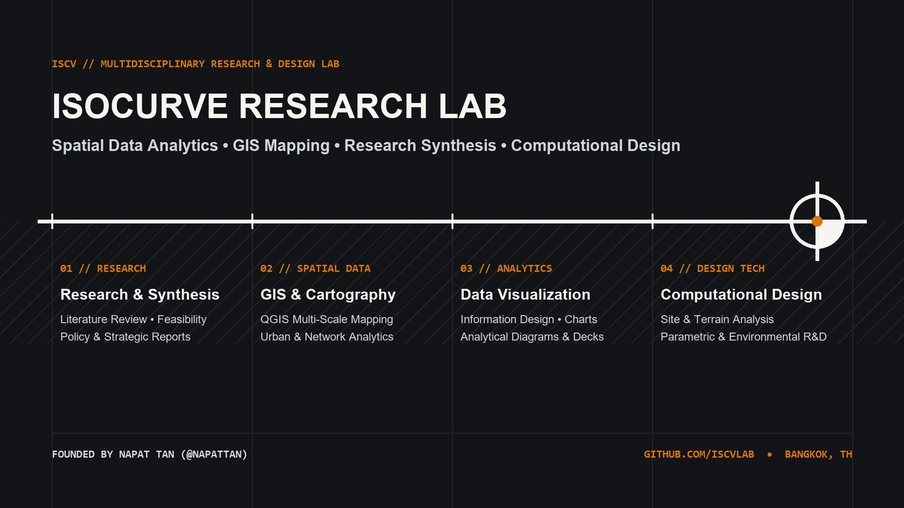

  

# ISCV | Isocurve Research Lab

### Research, Data Analysis, GIS & Computational Design

**ISCV | Isocurve Research Lab** (`@iscvlab`) is a multidisciplinary spatial data, GIS cartography, research synthesis, and computational design laboratory founded by **[Napat (Tan) Phasundhiae (`@napattan`)](https://github.com/napattan)** in Bangkok, Thailand. We engineer deterministic software tools, spatial analytics pipelines, and parametric workflows for the built environment.

[-121417?style=flat-square&logo=github&logoColor=white)](https://github.com/napattan)
[-0A66C2?style=flat-square&logo=linkedin&logoColor=white)](https://www.linkedin.com/company/iscvlab)

---

## Core Practice Pillars

| Pillar | Domain Focus | Key Capabilities & Stack |
| :--- | :--- | :--- |
| **01 // Research Synthesis & Strategy** | Evidence-Based Research & Feasibility | Systematic Literature Reviews • Policy & Regulatory Synthesis • Environmental & Sustainability Frameworks (LEED/WELL) • AI Research Workflows |
| **02 // Spatial Data & GIS Mapping** | Multi-Scale Cartography & Urban Analytics | QGIS Desktop & PyQGIS • Isochrone & Network Accessibility • Site & Terrain Suitability • Spatial SQLite & GeoPackage Pipelines |
| **03 // Data Analysis & Visualization** | Statistical Modeling & Visual Information Design | Exploratory Data Analysis (EDA) • Executive Dashboards • High-Precision Vector Plates • Analytical Diagrams & Publication Decks |
| **04 // Computational & Parametric Design** | Algorithmic CAD & Environmental Simulation | McNeel Rhinoceros 3D & Grasshopper • RhinoCommon (C# / Python) • Multi-Threaded Microclimate & Solar Solvers • Design-Tool Automation |

---

## Public Repositories & Open-Source Tooling

| Repository & Pillar | Status | Core Capability & Empirical Impact |
| :--- | :---: | :--- |
| **[boostx](https://github.com/iscvlab/boostx/releases/tag/v3.4.0)** `01 // Research & Workflows` | **LIVE** *(v3.4.0)* | Composable 13-skill `/x*` ecosystem and 8 deterministic Python CLI engines (`5,458` CLI LOC) compatible with **any AI coding agent — cloud, IDE, CLI, or local LLM** (`Claude`, `Grok`, `Gemini`, `Cursor`, `Codex`, `Ollama`, `OpenHands`, `Cline`, etc.), featuring the **[Compound Learning Playbook](https://github.com/iscvlab/boostx/blob/main/docs/COMPOUND_LEARNING_PLAYBOOK.md)** (`18` upstream open-source contributions, `4.0×–1,735.6×` speedups), delivering `100%` red-team defect recall across `25` seeded defects in `6.99 ms`, `-97.5%` briefing context noise reduction, and `13.73 ms` System 1 `/xlaya` section triage passing XERJ `#1108` with `0.00%` wrong-and-confident fires. |
| **[mcp-bridges](https://github.com/iscvlab/mcp-bridges)** `04 // Computational Design` | **LIVE** *(7 Bridges • Selected for [XERJ Corpus Hub](https://hub.xerj.org))* | Production Model Context Protocol (MCP) automation bridges connecting any cloud, IDE, CLI, or local AI agent to **QGIS, Rhinoceros 3D, Grasshopper, Adobe Illustrator, and Figma** with 1-prompt universal agent install and Parallel-Brains Single-Mouse `/xultra` swarm safety (`144` resolved `xerj autoindex` graph edges). |
| **[Upstream PR Contributions](https://github.com/iscvlab/boostx/blob/main/docs/COMPOUND_LEARNING_PLAYBOOK.md)** `01–04 // Open-Source R&D` | **LIVE** *(19 PRs & Issues • 12 Orgs)* | Empirical open-source bottlenecks & bugfixes powered by BoostX ([Full 18-Entry Benchmark Playbook](https://github.com/iscvlab/boostx/blob/main/docs/COMPOUND_LEARNING_PLAYBOOK.md)): • **Climate, ESG & Urban Physics (`4.0×–1,735.6×`)**: [os-climate/physrisk #651](https://github.com/os-climate/physrisk/pull/651) (`1,670×` geocoder, `32.5×` chronic heat) · [ladybug-tools/uwg #292](https://github.com/ladybug-tools/uwg/pull/292) (`1,736×` soil loop) · [Deltares/hydromt #1566](https://github.com/Deltares/hydromt/pull/1566) (`27.5×` mesh grid) · [CLIMADA #1349–#1350](https://github.com/CLIMADA-project/climada_python/pulls?q=is%3Apr+author%3Anapattan) (`69.3×` raster, `14.0×` CSR) · [natcap/invest #2813, #2829](https://github.com/natcap/invest/issues/2829) (`23.4×` urban cooling, `19.2×` flood) • **Geospatial & Vision**: [opengeos/geoai #960](https://github.com/opengeos/geoai/pull/960) · [segment-geospatial #569](https://github.com/opengeos/segment-geospatial/pull/569) · [pylandstats #77](https://github.com/martibosch/pylandstats/pull/77) (`4.0×` centroids) · [Weecology/DeepForest #1440](https://github.com/weecology/DeepForest/issues/1440#issuecomment-6657781223) · [gboeing/osmnx #1405](https://github.com/gboeing/osmnx/issues/1405#issuecomment-6657781737) • **Rust & Agent Infrastructure**: [xerj-org/xerj #2922–#2927](https://github.com/xerj-org/xerj/pulls?q=is%3Apr+author%3Anapattan) (`6` PRs: skill root auto-indexing, Thai PDF PUA, MSVC fixes, `0.00%` false-confident gate on [#1108](https://github.com/xerj-org/xerj/issues/1108)) • **Document AI & Vision**: [scb-10x/typhoon-ocr #15](https://github.com/scb-10x/typhoon-ocr/pull/15) (`1.3×–15×` faster pipeline, `-35.9%` to `-80.4%` vision tokens, `+9.11%` Table EditSim) |
| **[xocr](https://github.com/iscvlab/xocr)** `01 // Research & Document AI` | **LIVE** *(v2.1.0)* | High-speed C++ PyMuPDF vector/table extractor (`19-97 ms/page`, `15.0×-3,326×` faster hybrid routing), Two-Stage LaTeX `booktabs` & scanned HTML `<table>` → RFC-4180 CSV surgery, Thai PUA/Sara-Am normalizer, and 4-Tier local `SCB 10X Typhoon-OCR v1.5` (`Qwen3-VL`) & `baidu/Unlimited-OCR-2` engine. |
| **[qgis-axonometric-transformer](https://github.com/iscvlab/qgis-axonometric-transformer)** `02 // Spatial Data & GIS` | **LIVE** *(v1.2.2 • QGIS Portal [#6219](https://plugins.qgis.org/plugins/axonometric_transformer/))* | Official Qt6-verified (`QGIS 4 Ready`) plugin for 1-click 3D isometric, dimetric, and oblique axonometric map diagrams (`30×` faster than manual CAD) with multi-format transparent clipboard export (`PDF /SMask`, `SVG`, `PNG`, `CF_HDROP`) to Adobe Illustrator & Figma. |

---

## R&D Pipeline

| Initiative | Pillar | Status | Scope |
| :--- | :--- | :---: | :--- |
| **Bangkok Urban Analytics Demo** | `02 // Spatial Data` • `03 // Analytics` | **PREPARED** | Interactive city-scale spatial analytics showcase covering mobility, environmental comfort, demographics, and land use. |
| **OSSE Space Syntax Engine (`osse-space-syntax`)** | `02 // Spatial Data` • `04 // Design Tech` | **PREPARED** | Open-source spatial network topology, angular segment analysis, and visibility graph engine for Python & QGIS. |
| **Isocurve Simulation Suite** | `04 // Computational Design` | **IN PIPELINE** | Multi-threaded Grasshopper / RhinoCommon (C# & C++) solvers for urban microclimate and environmental performance analysis. |

---

## Leadership & Official Channels

- **Founder & Lead Technologist**: [Napat (Tan) Phasundhiae (`@napattan`)](https://github.com/napattan) • [Personal LinkedIn (`in/napatphas`)](https://www.linkedin.com/in/napatphas/)
- **Official Channels (`@iscvlab`)**: [LinkedIn (`company/iscvlab`)](https://www.linkedin.com/company/iscvlab) • [Instagram (`@iscvlab`)](https://www.instagram.com/iscvlab) • [Facebook (`@iscvlab`)](https://www.facebook.com/iscvlab)
- **Inquiries & Collaborations**: [tanfasantia@gmail.com](mailto:tanfasantia@gmail.com)
