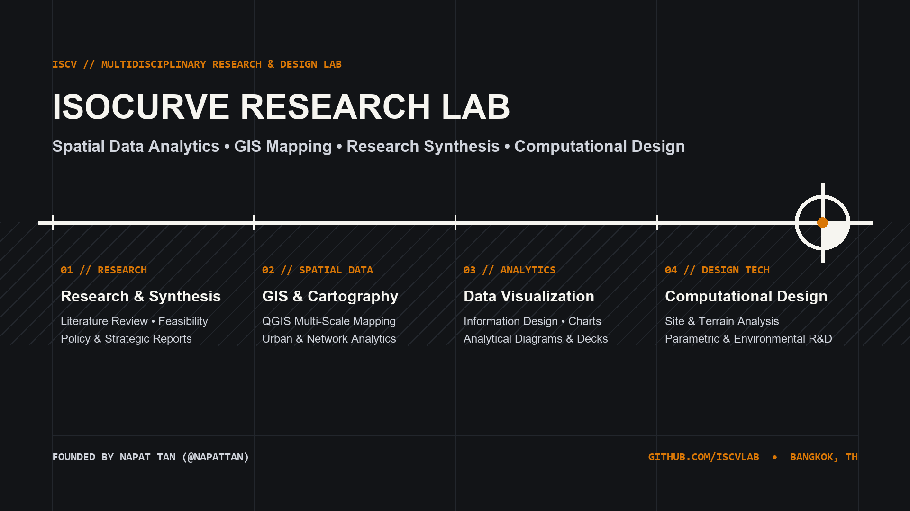

  

# ISCV | Isocurve Research Lab

### Geospatial Analytics, Climate Risk, GIS & Environmental Simulation

**ISCV | Isocurve Research Lab** (`@iscvlab`) is an independent geospatial data, GIS mapping, climate risk, and environmental simulation research lab created and maintained by **[Napat (Tan) Phasundhiae (`@napattan`)](https://github.com/napattan)** in Bangkok, Thailand. We build verifiable analytical frameworks, spatial analytics pipelines, and simulation workflows to support resilience across the built and natural environment.

---

## Core Practice Pillars

| Pillar | Domain Focus | Key Capabilities & Stack |
| :--- | :--- | :--- |
| **01 // Research Synthesis & Strategy** | Evidence-Based Research & Feasibility | Systematic Literature Reviews \| Policy & Regulatory Synthesis \| Environmental & Sustainability Frameworks (LEED/WELL) \| AI Research Workflows |
| **02 // Spatial Data & GIS Mapping** | Multi-Scale Cartography & Urban Analytics | QGIS Desktop & PyQGIS \| Space Syntax Network & Visibility Analysis (`SSE`) \| GeoAI Canopy Segmentation (`SAM 3` + `DeepForest 2.1`) \| Spatial SQLite & GeoPackage Pipelines |
| **03 // Data Analysis & Visualization** | Statistical Modeling & Visual Information Design | Exploratory Data Analysis (EDA) \| Executive Dashboards \| High-Precision Vector Plates \| Analytical Diagrams & Publication Decks |
| **04 // Computational & Parametric Design** | Algorithmic CAD & Environmental Simulation | McNeel Rhinoceros 3D & Grasshopper \| RhinoCommon (C# / Python) \| Multi-Threaded Microclimate & Solar Solvers \| Design-Tool Automation |

---

## Public Repositories & Open-Source Tooling

| Repository & Pillar | Status | Core Capability & Empirical Impact |
| :--- | :---: | :--- |
| **[CanopyGIS](https://napattan.github.io/CanopyGIS/)** ([GitHub](https://github.com/napattan/CanopyGIS) \| [Org Mirror](https://github.com/iscvlab/CanopyGIS)) `02 // Spatial Data & GeoAI` | **LIVE** *([v1.8.1](https://github.com/iscvlab/CanopyGIS/releases/tag/v1.8.1) \| [Live Demo](https://napattan.github.io/CanopyGIS/))* | Hybrid Tri-Engine urban tree canopy & treetop centroid extraction (**`SAM 3` + `Weecology DeepForest 2.1.0` + `Compact Geodesic Watershed + 3-Pass RAG`**) and zero-shot planar `MillionTrees v0.25` baseline ([`weecology/MillionTrees#184`](https://github.com/weecology/MillionTrees/pull/184) `OPEN`: **OOD `F1 = 0.744`**, `MaskAwareP = 0.936` `#1`, `AP40 = 0.439`, `AP60 = 0.350`; **WD `F1 = 0.604`**, `MaskAwareP = 0.882`; **TLS `Complete-59` `F1 = 0.627`**; `5,815` tiles / `458,851` crowns with `0` overlap pixels & `Euler = 1`, `4.27 GiB` peak GPU VRAM), alongside interactive VHR demos across **On Nut (`2,987` crowns)**, **Nong Khaem (`2,110` crowns)**, and **Ramintra (`1,432` crowns)** with `< 30 ms` real-time physical filter sliders and `-100%` (`< 4.0 m²`) micro-shard elimination (`1,568 → 0`). |
| **[sse-space-syntax](https://github.com/napattan/sse-space-syntax)** ([Org Mirror](https://github.com/iscvlab/sse-space-syntax)) `02 // Spatial Data` \| `04 // Design Tech` | **LIVE** *(v1.1.1 \| [QGIS Portal](https://plugins.qgis.org/plugins/sse/))* | Dual-engine **Native Rust Standalone Workstation (`sse-desktop`), CLI (`sse-cli`), 9-Tool MCP Server (`sse-mcp`)** & **Qt6-Ready PyQGIS Plugin** executing exact `UCL depthmapX v0.8.0` Tulip-1024 directed-segment parity (`R² = 1.0000`, `54.4×-57.8×` faster Angular Segment Analysis; `16.69 s` on Bangkok `166,514` segments in `< 16 MB` CSR RAM; `34.9×-144.3×` faster Axial; `35.8×` faster VGA & Analytical Isovists; `495.5×` faster Gibson Visual Agents). |
| **[xlaya](https://github.com/iscvlab/xlaya)** `01 // Research & Semantic AI` | **LIVE** *(v2.4.0 local \| [Release v2.3.0](https://github.com/iscvlab/xlaya/releases/tag/v2.3.0))* | Standalone 5-profile System 1 → System 1.5 semantic decision, regime-invariant 8D AST/code-graph sieve (`6,237 B` LF `sieve_genomes.json`), Wallacei `v2.7` K-Fold OOF `NSGA-II` MOO (`22/22` pytest, `12/12` `--self-test`), & conformal triage engine (`laya 0.4.31+` & `vegaml 0.16.1+`), pairing `--profile nano` (`0` PyTorch/NumPy, `8.50 MB` clean `nano` RSS, `3.74-3.99 ms` warm / `274.25 ms/repo` uncontended `v2.4` cold [`255.33 ms/repo` `v2.3`], `84.05%` disjoint val `31B R@8` / `70.83%` multi-hop / `0.0091` ECE, `65.12%` E4B `R@3` / `79.07%` 31B `R@8` on blind `Kaggle 129 R1`, `78.72%` `R@8` on `SWE-bench_Verified`, `81.37%` Val / `71.69%` MCQ `nvidia/When2Call` conformal tool gate, `86.21%` `PLE 29`) with 6-tool resident `stdio` MCP warm inference (`~30 ms`), `859.1 q/s` GPU batch (`8.9×` mixed EN/HI), `0.45/0.55` ensemble jury, `--thorough` 4-facet rubric + `file_summaries`, `--vega-views 1..3` debiasing, `xlaya_fit` persistent `TTTHead` (`90.0%`), local multimodal, and `0.00%` XERJ `#1108` wrong-and-confident fires. |
| **[xboost](https://github.com/iscvlab/xboost)** `01 // Research & Workflows` | **LIVE** *(v3.6.0 local \| [Release v3.5.0](https://github.com/iscvlab/xboost/releases/tag/v3.5.0))* | Composable 15-skill `/x*` ecosystem and 10 deterministic Python CLI & MCP engines (`22,237` LOC) compatible with **any AI coding agent - cloud, IDE, CLI, or local LLM** (`Claude`, `Grok`, `Gemini`, `Cursor`, `Codex`, `Ollama`, `OpenHands`, `Cline`, etc.), featuring the **[4-Tier Sharded Compound Learning Playbooks (`L1` Hub + `4 L2` Shards)](https://github.com/iscvlab/xboost/blob/main/docs/COMPOUND_LEARNING_PLAYBOOK.md)** (`/xlearn`, `24 PAT-*/OPT-*` across `21` families incl. `OPT-MOO-01`, `13 FALS-01..13`, `7 GOV-01..07`), `/xmouse` Background Ghost Mouse, `100%` red-team defect recall across `25` seeded defects in `8.14 ms`, `-97.06%` briefing context noise reduction, and 5-profile `/xlaya v2.4.0` (`8.50 MB` clean zero-torch `--profile nano`, `79.07%` Blind `Kaggle 129 R1` & `78.72%` `SWE-bench_Verified` `31B R@8`, `71.69%` `When2Call` MCQ, `~30 ms` warm 6-tool MCP / `859 q/s` GPU batch / `0.45/0.55` ensemble / `--vega-views 1..3` / `90.0%` `vega-U` routing) passing XERJ `#1108` with `0.00%` wrong-and-confident fires. |
| **[xocr](https://github.com/iscvlab/xocr)** `01 // Research & Document AI` | **LIVE** *(v2.4.0 local \| [Release v2.1.0](https://github.com/iscvlab/xocr/releases/tag/v2.1.0))* | High-speed C++ PyMuPDF vector/table extractor (`19-97 ms/page`, `15.0×-3,326×` faster hybrid routing), Two-Stage LaTeX `booktabs` & scanned HTML `<table>` → RFC-4180 CSV surgery, Thai PUA/Sara-Am normalizer, and 5-profile local `SCB 10X Typhoon-OCR v1.5` (`Qwen3-VL`) & `baidu/Unlimited-OCR-2` engine. |
| **[Upstream PR Contributions](https://github.com/iscvlab/xboost/blob/main/docs/COMPOUND_LEARNING_PLAYBOOK.md)** `01-04 // Open-Source R&D` | **LIVE** *(26 PRs + 1 Hold \| 11 MERGED \| 6 OPEN \| 13 Orgs)* | Empirical open-source bottlenecks & bugfixes powered by XBoost ([Full Benchmark Playbook](https://github.com/iscvlab/xboost/blob/main/docs/COMPOUND_LEARNING_PLAYBOOK.md)): - **Geospatial & Vision**: **[Weecology/DeepForest #1449](https://github.com/weecology/DeepForest/pull/1449) & [#1464](https://github.com/weecology/DeepForest/pull/1464) (MERGED, closed #1447 & #1440)** (`74×-421×` Shapely 2.0 vectorization & `os.PathLike`) \| **[weecology/MillionTrees #184](https://github.com/weecology/MillionTrees/pull/184) (`OPEN`)** (`CanopyGIS v1.8.1` zero-shot planar baseline: `OOD F1 = 0.744`, `MaskAwareP = 0.936` `#1`, `WD F1 = 0.604`, `TLS-59 F1 = 0.627`) \| **[opengeos/geoai #960 (MERGED)](https://github.com/opengeos/geoai/pull/960)** \| **[gboeing/osmnx #1412 (MERGED, closed #1410)](https://github.com/gboeing/osmnx/pull/1412)** & #1405 (`40.2×` speedup) \| [martibosch/pylandstats #77](https://github.com/martibosch/pylandstats/pull/77) (`OPEN`, `4.0×` centroids) \| [opengeos/segment-geospatial #569](https://github.com/opengeos/segment-geospatial/pull/569) (`Closed` to rescope) - **Climate, ESG & Urban Physics**: **[CLIMADA #1350 (MERGED)](https://github.com/CLIMADA-project/climada_python/pull/1350)** → [#1358](https://github.com/CLIMADA-project/climada_python/pull/1358) (`OPEN`, Fixes `#1357`) & [#1349](https://github.com/CLIMADA-project/climada_python/pull/1349) (`OPEN`; `69.9×` `apply_box` / `11.7×` CSR `impact_at_reg` & `#1331` World Bank ISO fallback) \| [Deltares/hydromt #1566](https://github.com/Deltares/hydromt/pull/1566) (`OPEN`, `27.5×` speedup & `#1563` non-EPSG:4326 basin CRS) \| [os-climate/physrisk #651](https://github.com/os-climate/physrisk/pull/651) (`OPEN`, `17.5×` Chronic Heat) \| [ladybug-tools/uwg #292](https://github.com/ladybug-tools/uwg/pull/292) (`Closed` - dormant repo; `1,735.6×` speedup & `#291`) \| [natcap/invest #2813, #2829](https://github.com/natcap/invest/issues/2829) (`Hold`; `23.1×` UCM & `18.1×` UFRM; `#2839 Closed`) \| [`UMEP-dev #885, #149, #6`](https://github.com/UMEP-dev/UMEP/pull/885) (`3 Staged`: `173.0×` UTCI, `799.8×` `load_walls`) - **Rust & Agent Infrastructure**: **[xerj-org/xerj #2922-#2927 (6/6 MERGED)](https://github.com/xerj-org/xerj/pulls?q=is%3Apr+author%3Anapattan)** (`6` PRs: skill root auto-indexing, Thai PDF PUA, MSVC fixes, `0.00%` false-confident gate on [#1108](https://github.com/xerj-org/xerj/issues/1108)) \| [scb-10x/typhoon-ocr #16](https://github.com/scb-10x/typhoon-ocr/pull/16) (`Closed` - dormant repo, `#15 Closed`, `-35.9%` vision tokens) \| [mufeedvh/code2prompt #348](https://github.com/mufeedvh/code2prompt/pull/348) (`Closed`) |
| **[mcp-bridges](https://github.com/iscvlab/mcp-bridges)** `04 // Computational Design` | **Supporting Utility** *(8 Bridges \| Selected for [XERJ Corpus Hub](https://hub.xerj.org))* | Supporting Model Context Protocol (MCP) automation bridges connecting any cloud, IDE, CLI, or local AI agent to **AutoCAD, QGIS, Rhinoceros 3D, Grasshopper, Adobe Illustrator, and Figma** (`8` skills incl. Ghost Mouse Companion) with 1-prompt universal agent install and Parallel-Brains Single-Mouse `/xultra` swarm safety (`144` resolved `xerj autoindex` graph edges). |
| **[qgis-axonometric-transformer](https://github.com/iscvlab/qgis-axonometric-transformer)** `02 // Spatial Data & GIS` | **Supporting Utility** *(v1.2.2 \| QGIS Portal [#6219](https://plugins.qgis.org/plugins/axonometric_transformer/))* | Supporting Qt6-verified (`QGIS 4 Ready`) plugin for 1-click 3D isometric, dimetric, and oblique axonometric map diagrams (`30×` faster than manual CAD) with multi-format transparent clipboard export (`PDF /SMask`, `SVG`, `PNG`, `CF_HDROP`) to Adobe Illustrator & Figma. |
| **[bangkok.iscvlab.com](https://bangkok.iscvlab.com)** `02 // Spatial Data` \| `03 // Analytics` | **WORKING PROTOTYPE** *(Secondary / In Polish \| 8 Dashboards A-H)* | Interactive city-scale Bangkok Macro Spatial Intelligence Suite (`A-H`) backed by `tiles.iscvlab.com` Cloudflare R2 PMTiles vector tiles covering transit accessibility, environmental comfort, land use, and urban ecology. |

---

## R&D Pipeline

| Initiative | Pillar | Status | Scope |
| :--- | :--- | :---: | :--- |
| **environmental-simulation (`Iscv.EnvSim`)** | `04 // Computational Design` | **PREPARED** | Standalone GPU & CPU environmental physics engines (`D3Q19 LBM Wind CFD`, `ISO 9613-2:1996 8-Band Outdoor Acoustics`, `Tregenza/Reinhart Perez Solar & SVF Raycaster`) validated against `AIJ/CEDVAL`, `ISO/TR 17534-3`, and `CIE 171:2006` benchmarks. |
| **Timberpin Field Sensing** | `04 // Design Tech` \| `IoT` | **PREPARED** | Handheld environmental telemetry & acoustic tree tomography ground-truthing hardware (`ESP32` + `Bosch BME688`). |

---

## Leadership & Official Channels

- **Creator & Open-Source Maintainer**: [Napat (Tan) Phasundhiae (`@napattan`)](https://github.com/napattan) | [Personal LinkedIn (`in/napatphas`)](https://www.linkedin.com/in/napatphas/)
- **Official Channels (`@iscvlab`)**: [LinkedIn (`company/iscvlab`)](https://www.linkedin.com/company/iscvlab) | [Instagram (`@iscvlab`)](https://www.instagram.com/iscvlab) | [Facebook (`@iscvlab`)](https://www.facebook.com/iscvlab)
- **Inquiries & Collaborations**: [tanfasantia@gmail.com](mailto:tanfasantia@gmail.com)
